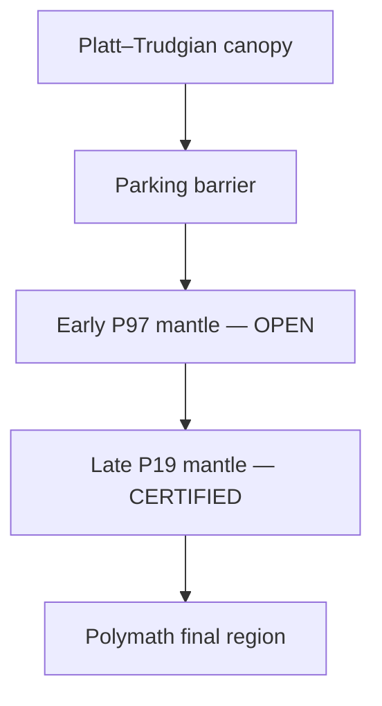

# Lambda 0.14 proof program — research checkpoint

> **Status (27 August 2026): not a proof of** `Lambda <= 0.14`.
>
> After accepting the Platt--Trudgian initial-canopy theorem and the published
> Polymath final-region computation as external inputs, the active moving-cutoff
> route reduces the claim to one explicit finite workspace certificate: the
> early correlated P97 mantle. The late P19 mantle passes the fail-closed
> workspace replay. Every global promotion flag remains false until the early
> mantle is also certified.

## Latest update — 28 August 2026

[The early-P97 progress checkpoint](./EARLY_P97_PROGRESS_2026-08-28.md)
records the exact event DAG, full coefficient-level vertical atlas,
directional-center reduction, branch-free smooth-prefix gates, the
bottom-to-vertical no-go, and the scalable endpoint-packet plan. It also
records the current P97 quarter-tail target and the smaller P7 candidate.
All mantle and global promotion flags remain false.

## Latest update — 29 August 2026

[The long-window Fejér reduction](./SMOOTH_TAIL_FEJER_REDUCTION_2026-08-29.md)
certifies the recombined smooth-tail coefficient energy and replaces the
provisional short-window correlation target by the exact \(K=L\) gate

\[
\frac2L\Re\sum_{r=1}^{L-1}(L-r)C_r<\frac1{43}.
\]

This is more than eighteen times looser than the earlier \(1/800\) target.
The signed correlation inequality itself, both vertical faces, and every
global promotion flag remain open.

This directory connects the exact `0.14` work to the existing MathExplorer
frozen-rung, closure-route, and zero-flow material without changing the app.
It is a research checkpoint: theorem notes, proof ledgers, and evidence
bindings only. It adds no route, runtime dependency, build step, or deployment
surface.

## The target

The exact moving-cutoff endpoint is

\[
T=\frac{33}{250},\qquad Y(T)^2=\frac{2}{125},\qquad
T+\frac{Y(T)^2}{2}=\frac7{50}=0.14.
\]

If completed, the construction would join the Platt--Trudgian verified-height
region to the published Polymath final region by a positive-time swept side
tube. It would thereby replace the conditional RH verification through height
`3e16`; it has not yet done so.



After the two named external imports, only the arrow through the early P97
mantle is missing. If that closed mantle is certified with the stated strict
margins, the cap-aware first-contact theorem yields `Lambda <= 7/50`. Until
then, it does not.

## Three routes and their present status

| Route | What it would replace | Present status |
|---|---|---|
| Buffered one-rung winding | Full RH verification to the Polymath row height | Exact sufficient reduction obtained; the height-`3e16` winding is not computed |
| Frozen-rung arithmetic repulsion | Point-by-point zero verification | Separation/repulsion lemmas remove a cancellation loophole; conversion to a uniform block witness is open |
| Moving-cutoff swept tube | The missing high initial-time winding | Active route; late mantle certified, early correlated mantle open |

The first two routes explain why the project moved to the third. The one-rung
reduction is exact but computationally huge. Arithmetic repulsion removes a
discrete cancellation loophole, but it does not supply the minimum-modulus or
prime-witness estimate needed for a contradiction. The swept-tube route moves
that burden to a finite positive-time mantle.

## Exact remaining certificate

Define

\[
\lambda_h=\frac{23514296330019}{500000000000000}
=0.047028592660038,
\]

\[
t(\lambda)=\frac{26399999+\lambda}{200000000},\qquad
R(\lambda)=6000000185827+59993999999971158\lambda,
\]

\[
Y(t)=\sqrt{\frac7{25}-2t},\qquad U(t)=\sqrt{1-2t}.
\]

It is sufficient to certify `H_{t(lambda)}(z) != 0` for
`0 <= lambda <= lambda_h` on all three closed faces

\[
\begin{aligned}
\mathcal B_\lambda &: y=Y(t(\lambda)),
&R(\lambda)\le x\le R(\lambda)+\frac{17}{20},\\
\mathcal V^-_\lambda &: x=R(\lambda),
&Y(t(\lambda))\le y\le U(t(\lambda)),\\
\mathcal V^+_\lambda &: x=R(\lambda)+\frac{17}{20},
&Y(t(\lambda))\le y\le U(t(\lambda)).
\end{aligned}
\]

This contains the inclusive selector range

\[
690988\le N\le14999999,
\]

including both lambda endpoints and every selector seam.

## What is already complete in the workspace stack

| Component | Scope | Status |
|---|---|---|
| Cap-aware moving cutoff | Width `17/20`; exact squared clearance `1/400` | Proved in the workspace theorem stack |
| Parking barrier | Initial cross-section | Certified; minimum margin `> 0.09351171649` |
| Analytic transfer | Ordinary and half-jump ramp charts | Certified |
| P19 coefficient theorem | All 256 masks and 255 nonempty supports | Proved and audited |
| Late P19 mantle | `lambda_h <= lambda <= 1` | 266 cells, 798 transcripts, 10,640 interval containments; minimum padded margin `> 0.00132120036607` |
| P97 endpoint core | All early selectors and relevant one-sided seam charts | Cubicization radius `< 497/16950000 < 3e-5`; correlated centers and complementary bulk remain open |
| First-window vertical transport | First complete early selector window | Phase drift `< 5.41e-14`; correlated center remains open |

Published imports and workspace certificates are deliberately kept distinct in
the execution and status ledgers.

## Included notes

- [`EXECUTION_LEDGER.md`](./EXECUTION_LEDGER.md) — top-level result, exact open
  theorem, negative results, next producer, and replay commands.
- [`MOVING_CUTOFF_COMPLETION_THEOREM.md`](./MOVING_CUTOFF_COMPLETION_THEOREM.md)
  — the exact theorem that turns a closed swept tube into `Lambda <= 7/50`.
- [`P19_SWEPT_FAMILY_THEOREM.md`](./P19_SWEPT_FAMILY_THEOREM.md) — the
  completed late-family certificate, including its audited coefficient
  dependencies.
- [`AIRY_ENDPOINT_KERNEL_THEOREM.md`](./AIRY_ENDPOINT_KERNEL_THEOREM.md) and
  [`VERTICAL_GAMMA_THEOREM.md`](./VERTICAL_GAMMA_THEOREM.md) — the two newest
  early-mantle structural reductions.
- [`EVIDENCE.md`](./EVIDENCE.md) — immutable source hashes and replay-bundle
  handling.

Historical one-rung and frozen-rung experiments are summarized above rather
than copied into this active checkpoint. That avoids presenting an older route
note as the current execution ledger.

## Existing MathExplorer connections

- [Frozen-rung equivalence page](../../src/pages/FrozenRungPTEquivalencePage.jsx)
  and [status data](../../src/data/frozen-rung-pt-equivalence-2026-07-31.js)
- [Frozen-rung paper](../../public/frozen-rung-pt-equivalence.pdf)
- [Closure routes](../../src/pages/ClosureRoutesPage.jsx)
- [Freezing bridge](../../src/pages/FreezingBridgePage.jsx)
- [Flow-blindness no-go](../../src/pages/FlowBlindnessNoGoPage.jsx)
- [Lambda roadmap](../../src/data/lambda-roadmap.js),
  [SOTA assembly](../../src/data/lambda-sota-assembly.js), and
  [RH-height mapping](../../src/data/lambda-rh-height-mapping.js)
- [Polymath bridge data](../../src/data/lambda-polymath15-bridge.js),
  [Lambda bounds page](../../src/pages/LambdaBoundsPage.jsx), and
  [Lambda timeline](../../src/pages/LambdaTimelinePage.jsx)

Those app surfaces are references only; this checkpoint does not alter them.
The legacy [`src/math/lambda-final-assembly.js`](../../src/math/lambda-final-assembly.js)
is a low-confidence extrapolation from a small zero sample and is not an
authoritative status source for this proof program.

## Honesty contract

Any future integration may change the headline to a proved bound only after a
source-bound replay derives all four terminal flags as true:

```text
P19_LATE_FAMILY_MANTLE_CERTIFIED true
CORRELATED_PREHANDOFF_MANTLE_CERTIFIED true
SWEPT_TUBE_NONVANISHING true
LAMBDA_LE_7_OVER_50 true
```

At this checkpoint the final three values are false.
