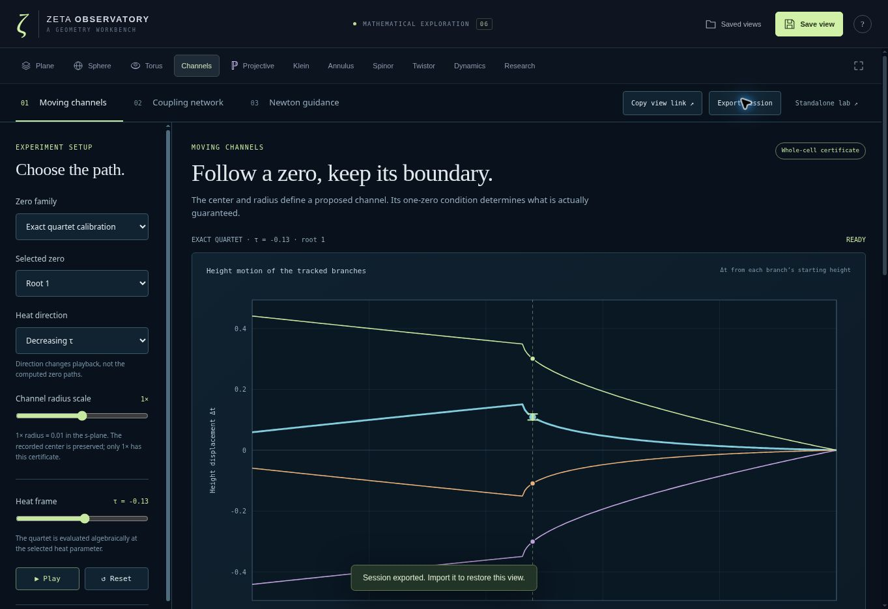

# Channels in the main renderer

Follow-up: 2026-11-14. Companion to [research PR #57](https://github.com/judegomila/mathexplorer/pull/57).

Renderer integration commit: `3db4bd3d72651d23663859fd67e15b762d77d31f` in `judegomila/zeta-view`. The browser fetch compatibility follow-up is `b5b5cc6ac0cf170172ddd66477aaa1b539c24dbe`.

## Entry points

The main renderer exposes the existing laboratory as a Channels workbench, alongside its other visualization modes. The controls and plots remain available inside the app.

| Main-app link | Starting view |
| --- | --- |
| [Channels](https://zeta-view.vercel.app/?view=channels) | Actual theta channels and the first-root disk. |
| [Coupling](https://zeta-view.vercel.app/?view=coupling) | Inverse squared gap network and frozen perturbation. |
| [Newton guidance](https://zeta-view.vercel.app/?view=newton) | Seeded probes moving through a fixed actual-theta field. |
| [Quartet channels](https://zeta-view.vercel.app/?view=channelsQuartet) | Four certified moving channels at `tau=-0.13`. |

The [standalone laboratory](https://zeta-view.vercel.app/experiments/zero-channels.html) remains available with its existing URLs.

## Controls and shared state

The shared controls include the view, zero family, selected branch, heat frame, direction, radius scale, probe spread and seed, probe travel, and the relevant integration or perturbation duration. The exact quartet collision is represented by an explicit checkpoint, preserving its singular meaning when a view is shared.

The main app owns the address bar, history, saved views, and session restoration. Its named `view` parameter selects the starting point; allowlisted overrides use the existing session-state URL format. Channel controls have `channels`-prefixed names in app state. A conversion layer maps them to the laboratory's existing state, so the plots and mathematics use the same engine as the standalone page.

The embedded laboratory reports control changes to the parent app and does not install a competing URL or Back handler. Discrete choices can create history entries; continuous adjustments update the current entry. Copying or saving a view captures the selected settings even while a numerical worker is completing its computation.

Shared links, browser Back, and restored sessions open paused. The selected heat frame and probe travel position are retained; a running animation clock is not serialized. Equal-state updates from the parent do not restart or pause ongoing local playback. Switching to another app mode pauses the laboratory.

State-level checks cover all laboratory controls, short links, precise fractional quartet frames, malformed inputs, bounded numerical work, collision checkpoints, existing app mode names, and Back restoration across a surface view. The initial focused renderer suite passed 81 tests spanning the channel mathematics and integration, existing quotient and research panels, routing, and URL round trips. Production inspection then exposed a native browser fetch receiver requirement. The follow-up binds the fetcher to its owning Window and adds a regression for both UI assets and forwarded JSON requests; all 15 panel/UI cases pass after the fix, bringing the focused coverage to 82 cases.

## Mathematical scope

This integration reuses the prior certificate and numerical data. It adds no new mathematical claim:

- The exact quartet has four disjoint certified moving disks of radius `0.01` for every `-0.13 <= tau <= 0`.
- The actual-theta certificate covers one fixed first-root disk of radius `0.35` for every `-0.05 <= tau <= 0.05`. Other tracked theta channels remain numerical candidates.
- Changed disk geometry does not inherit the recorded certificate. Collision and off-line states retain their stated limitations.
- The theta coupling graph contains only the tracked roots. Newton paths move probes through a fixed field; they do not relocate the field's zeros.

The certificate generator, saved bounds, replay output, and original provenance are preserved. See [the mathematical note](ZERO-CHANNELS-MATH.md) and [reproduction instructions](README.md) for the full finite claims and their verification. No global RH conclusion follows from this interface change.

## Production verification

Production deployment `b5b5cc6ac0cf170172ddd66477aaa1b539c24dbe` reached READY on 2026-11-14. The browser check confirmed:

- The main navigation selects Channels and the embedded laboratory renders inside the main app. Moving Channels, Coupling, and Newton guidance each update the main-app URL.
- The actual-theta start displays `1 / 3 certified`. The quartet starting point restores the exact fractional frame `124.8` (`tau=-0.13`) and displays four rows marked `Certified · one zero`.
- Newton probe playback advances without a parent URL update stopping it. A changed seed and paused travel position survive reload. Leaving for the plane surface and using browser Back restores the same paused Channels state.
- The Copy view link control reports success with the main-app URL. Export session downloads valid JSON containing `channelsMode=channels`, `channelsModel=quartic`, `channelsFrame=124.8`, and `camera=null`.
- The standalone laboratory still loads its original controls, charts, and certificate display.

The screenshot below shows the quartet channel preset inside the main renderer, including the app navigation, channel controls, plot, and successful session-export notice.

