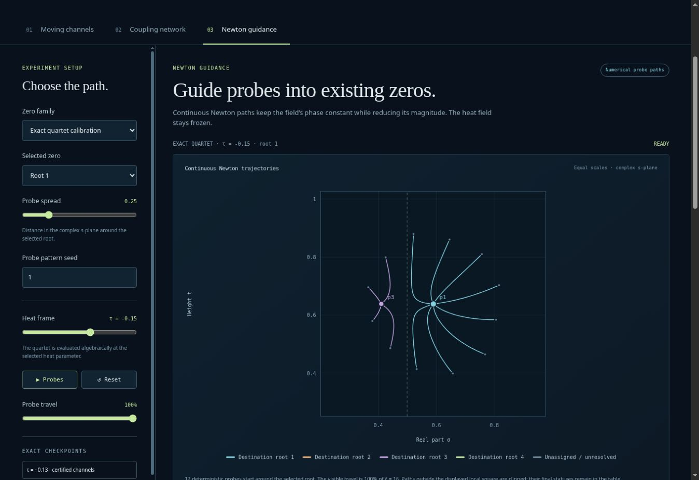

# Zero channels, coupling, and Newton guidance

Research log: 2026-11-14. Companion implementation: [`judegomila/zeta-view`](https://github.com/judegomila/zeta-view), renderer commit `ee749ce5ea91bc336896d3ab87ac4faca1401cc3`.

Live experiment: [Zero channels laboratory](https://zeta-view.vercel.app/experiments/zero-channels.html).

## Result and scope

This session turns the proposed “super wires” into three precise constructions: a local coupling graph, zero-count channels, and Newton paths for test points. Two finite statements have executable certificates:

| Family | Certified region | Arithmetic and conclusion |
| --- | --- | --- |
| Exact quartet | Four pairwise-disjoint moving disks of radius `1/100`, for every `tau` in `[-13/100, 0]` | Exact rational Bernstein and Taylor–Rouché bounds. Each disk contains exactly one simple zero. All four polynomial zeros are covered. |
| Actual theta heat family | One fixed disk centered at `1/2 + 14.134725141734693 i`, radius `7/20`, for every `tau` in `[-1/20, 1/20]` | Arb ball arithmetic, explicit analytic tail bounds, and rational final inequalities. Exactly one simple zero lies in this disk and on the critical line. |

The actual-theta certificate is local. The other two tracked branches and the wider saved trajectories remain numerical. It establishes no all-height zero census, no global de Bruijn–Newman bound, and no proof of RH. The browser displays the saved certificates; the Python verifier independently recomputes the claims.

## What changed

### 1. Moving channels

The interactive view draws the zero trajectories, the selected channel, its radius, neighboring clearance, and its one-zero status. The local disk plot has equal scales on both axes. A separate displacement plot makes small height changes visible and labels each branch's own reference height.

For the quartet, the centers are recorded rational piecewise-affine paths. Bounds cover the whole time cell and whole complex disk, rather than just a sequence of sample points. There are 130 time cells and 520 branch-cell checks. The minimum strict Taylor–Rouché margin is approximately `0.020444320768133732`, and the minimum clearance between disks is approximately `0.07010952625620315`.

The quartet result continues individual assignment past the earlier fixed-disk failure near `tau = -0.0817542507988577`, up to `tau = -0.13`. It stops before the exact collision at `tau = -(10 - sqrt(46))/24`, approximately `-0.13406958403644717`. At a collision two simple branches cannot retain separate one-zero disks.

For actual theta, the certified disk is fixed and applies only to the first tracked root. Rounded rational bounds are:

| Quantity | Certified bound |
| --- | ---: |
| Center residual at `tau=0` | `E <= 2e-18` |
| First derivative at the center | `A >= 0.0013827` |
| Second derivative throughout the reference disk | `B <= 0.0021` |
| Initial boundary modulus | `>= 0.000355319999999998` |
| Uniform heat perturbation on that disk and `abs(tau)<=0.05` | `<= 0.00029` |
| Remaining strict boundary margin | `>= 0.000065319999999998` |

The initial Taylor–Rouché inequality gives a count of one. A second Rouché comparison preserves the count throughout the stated heat interval. Reflection symmetry forces the unique zero onto the critical line. The computation includes 128 boundary nodes, a rigorous third-derivative bound between nodes, the missing theta-series terms, and the infinite integration tail. The mathematical note gives the complete normalization and bounds.

Changing a radius preserves its recorded center and base radius but removes the certificate label. The app reports `1 / 3 certified` in the actual-theta window; it does not promote the other two channels to certified status.

### 2. Coupling network

For critical-line heights, the finite model has weights `w_ij = 1/(gamma_i-gamma_j)^2` and linearization `eta' = -L eta/2`. Increasing heat time damps relative perturbations; decreasing time reverses that behavior. The translation mode remains neutral, so this interaction alone does not select absolute destination heights.

The view exposes the weighted graph, eigenvalues, perturbation direction, and frozen-frame norm curve. The actual-theta graph is explicitly a three-root observed subgraph. The actual trajectories and velocities come from the theta family, not from that truncated graph. An omitted infinite-root contribution has not been bounded. At a multiple root or off-line configuration, the positive height-Laplacian representation is disabled rather than regularized into an apparently finite answer.

### 3. Newton guidance

The fixed-field flow `ds/dell = -F/F_s` satisfies `F(s(ell)) = exp(-ell) F(s(0))` wherever the solution is defined. It preserves phase and reduces magnitude. The view animates deterministic seeded test points and colors their resolved destinations, including off-line polynomial zeros. The selected heat field stays fixed while the probes move.

The interface preserves critical-point, domain-exit, unresolved-destination, and integration-failure states. Local attraction to a simple zero does not imply that every seed reaches a prescribed zero. The recorded phase and decay errors are numerical diagnostics, not validated ODE enclosures.

## Reproduce the certificates

Run commands from this directory. Python 3.11 or later is recommended. The exact quartet check needs only the standard library:

```bash
python3 zero-channel-bounds.py --verify-existing channel-bounds.json --self-test
```

For the actual-theta certificate and optional numerical audit, create an isolated environment and install the pinned dependencies:

```bash
python3 -m venv .venv
.venv/bin/python -m pip install -r requirements.txt
.venv/bin/python zero-channel-bounds.py --verify-existing channel-bounds.json --with-arb --self-test
```

The second command recomputes the Arb bounds; it does not trust the saved quadrature transcript or `certified` flag. To regenerate the full report from the included compact theta input:

```bash
.venv/bin/python zero-channel-bounds.py --theta-data theta-input.json --output regenerated-bounds.json --with-arb --self-test
```

Timestamps and arithmetic transcripts can differ on regeneration. Exact certificate constants and verified conclusions must agree. The numerical theta audit remains explicitly uncertified, even when its estimated margins are positive.

## Files and provenance

| File | Purpose |
| --- | --- |
| `ZERO-CHANNELS-MATH.md` | Derivations, time conventions, theorem conditions, tail bounds, and limitations. |
| `zero-channel-bounds.py` | Exact quartet generator/verifier and optional actual-theta Arb verifier. |
| `channel-bounds.json` | Full certificates plus the numerical audit of all 723 saved frames and 2,169 root records. |
| `theta-input.json` | Compact input retaining every tracked root record needed for that audit. |
| `verification.json` | Output of an independent replay of the saved certificate and its negative controls. |
| `requirements.txt` | Pinned optional mathematical dependencies. |
| `newton-guidance.jpg` | Production screenshot of the off-line quartet guidance control. |
| `provenance.json` | Source commits, transformations, and SHA-256 file hashes. |

The numerical input derives from `dist/experiments/zero-confinement-theta.json` at renderer commit `1dcaf3f73ae59a528ae5e8dd67b8f672fbdba911`. The compact copy removes contour arrays and unrelated diagnostics while preserving all frame times and root records used by the audit. The actual-theta certificate is independently evaluated from the analytic family and does not rely on those approximate root trajectories as proof.

The earlier [zero-confinement comparison](https://zeta-view.vercel.app/experiments/zero-confinement.html) supplies the fixed-disk collision control and the bridge-shear comparison. The current mathematical note records why circulation, synchronization, and probe attraction by themselves do not establish individual confinement.

## Validation and remaining questions

The renderer's focused suite passes 10 mathematical tests, six UI/state tests, and 10 existing research-panel integration tests. These cover the physical time sign, all quartet cells, collision semantics, actual-theta certificate scope, Newton identities and failure cases, deterministic seeds, view URL round trips, browser Back restoration, stale-worker suppression, and cached probe animation. Certificate self-tests reject an inflated derivative floor, missing time cell, displaced displayed center, forged margin, and an enlarged unsupported theta time interval.

Production browser verification covered all three views, the theta interval endpoint, all four quartet channels, loss of certification after resizing, singular coupling at collision, actual-theta and off-line quartet Newton probes, seed changes, paused reload, browser Back, copied view links, and links from the main renderer and comparison page. A visual review also corrected an overbroad keyboard-focus selector. The main plot is 520 pixels high at the verified desktop viewport.



The next mathematical work is to certify additional actual-theta channels with uniform time coverage and explicit disjointness, and to bound omitted terms in any infinite-root coupling argument. The certificate here deliberately makes the existing finite progress reproducible without changing the repository's global RH status.
